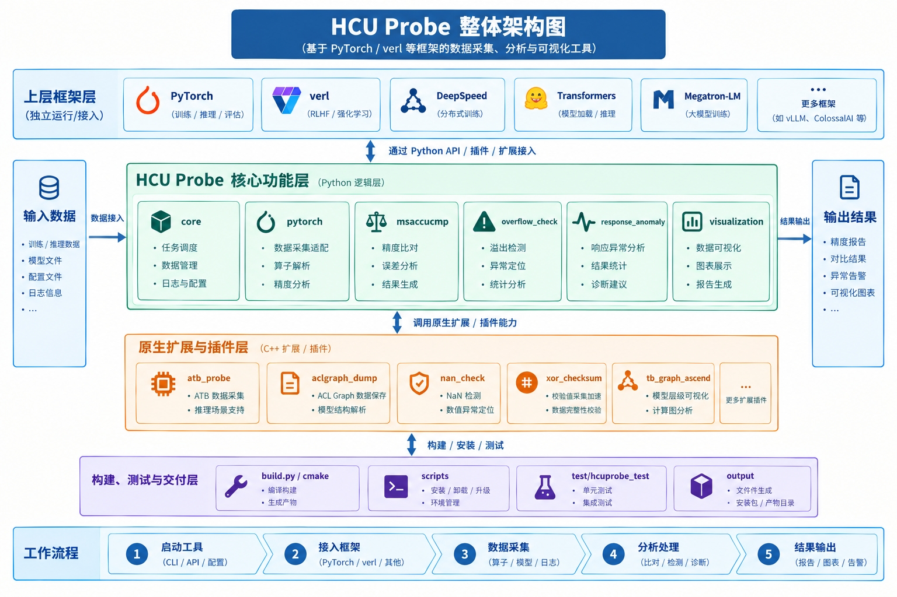

<div align="center">

<h1 style="text-align: center;">hcuprobe: 海光 HCU 训练精度调试工具</h1>

<h3 align="center">面向 PyTorch 分布式训练 / 推理的逐层 dump · 精度比对 · 训推一致性验证</h3>

<p align="center">
| <a href="docs_hcu/UPSTREAM_SYNC.md"><b>上游同步</b></a>
| <a href="docs_hcu/zh/quick_start/pytorch_quick_start.md"><b>快速入门</b></a>
| <a href="docs_hcu/zh/user_guide/README.md"><b>使用指南</b></a>
| <a href="docs_hcu/zh/support/faq.md"><b>FAQ</b></a>
|
</p>

[](docs_hcu/UPSTREAM_SYNC.md)
[](docs_hcu/UPSTREAM_SYNC.md#license-与署名)
[](https://gitcode.com/Ascend/msprobe)

</div>

<div align="left">

简体中文 | [English](README_EN.md)

## ℹ️ 简介

hcuprobe 是海光 HCU 平台的训练精度调试 Python whl 包,给在 HCU 上训练的团队提供一套「采集 → 比对 → 定界」的精度工具:训练时逐层 dump 张量统计量、监测梯度 / 优化器 / 参数,训练后离线做两端精度比对、溢出定位、API 精度预检,以及 RL 场景的训推一致性验证。



hcuProbe 采用分层架构设计，通过 Python 核心功能模块与 C/C++ 原生扩展协同工作，为 PyTorch、verl、Megatron-LM 等训练与推理框架提供精度调试能力。项目覆盖数据采集、精度分析、异常检测、结果可视化及报告生成等环节，并提供相应的构建、测试和交付工具。

它基于华为 [`mindstudio-probe`(msProbe)](https://gitcode.com/Ascend/msprobe) `26.2.0` 适配:核心 dump / 比对内核与上游一致，HCU 侧自维护多框架训练接入的翻译层。命名空间 `msprobe.*` → `hcuprobe.*`,CLI 命令 `msprobe` → `hcuprobe`。版本对齐详见 **[上游同步说明](docs_hcu/UPSTREAM_SYNC.md)**。

## ⚙️ 功能介绍

hcuProbe 围绕模型精度调试提供三大核心能力，覆盖「数据采集 → 精度比对 → 可视化」完整流程：

| 核心功能 | 功能说明 | 快速入口 |
|---|---|---|
| 数据采集 | 通过 config.json 配置，一键采集模型训练/推理过程中的精度数据 | [PyTorch 数据采集](docs_hcu/zh/user_guide/dump/pytorch_data_dump_instruct.md) |
| 精度比对 | 将采集到的精度数据进行比对，定位出现精度差异的网络层/算子 | [PyTorch 精度比对](docs_hcu/zh/user_guide/accuracy_compare/pytorch_accuracy_compare_instruct.md) |
| 可视化 | 解析 dump 数据还原模型图结构，分级可视化定位精度差异 | [分级可视化构图比对](docs/zh/user_guide/accuracy_compare/pytorch_visualization_instruct.md) |

> 上表为最常用的 PyTorch 场景入口。更多框架及使用场景请参见《[hcuProbe 使用指南](docs_hcu/zh/user_guide/README.md)》。

## 🚀 快速入门

快速一站式体验数据采集、HCU/GPU 精度比对与分级可视化构图比对的完整流程，请参见《[hcuProbe 快速入门](docs_hcu/zh/quick_start/pytorch_quick_start.md)》。


## 📦 安装指南

```bash
# 方案 A:源码 build(本仓)
git clone https://github.com/HYGON-AI/hcu_probe-das
cd hcu_probe-das
pip wheel . --no-deps -w dist/
pip install dist/hcuprobe-*.whl --no-deps

# 方案 B:editable(开发用)
pip install -e .

# 方案 C:GitLab Releases 页下载 prebuilt whl 直接 pip install

# 离线分析 precheck 扩展(onnx / onnxruntime / skl2onnx)
pip install hcuprobe[precheck]
```

> **注意:** `torch` 不在依赖里,由用户在训练环境自备(HCU / NV / H20 各自的 torch 构建)。
## 📘 使用指南

工具的详细使用方法，请参见《[hcuProbe 使用指南](docs_hcu/zh/user_guide/README.md)》。

## ❓ FAQ

常见问题及解决方案汇总，请参见《[FAQ](docs_hcu/zh/support/faq.md)》。

## 🔄 上游同步

hcuprobe 是 msProbe 的 HCU 适配。内核子树 `core / pytorch / visualization / overflow_check / msaccucmp` 与上游一致,`integrations / tools` 为 HCU 侧自维护。**本仓未覆盖的上游功能**(如 `checkpoint_compare`、`response_anomaly`、accuracy_checker 细节等)可参考上游 user_guide,注意 `msprobe` → `hcuprobe` 命令映射、跳过 NPU / 昇腾专属能力。

**→ [上游同步说明](docs_hcu/UPSTREAM_SYNC.md)**

## ⚖️ 许可证

- **代码**: 沿用上游 msProbe 的[木兰宽松许可证 第 2 版(Mulan PSL v2)](LICENSE)。
- **文档**: 上游 `docs/` 为 CC-BY 4.0([docs/LICENSE](docs/LICENSE));从上游文档复制内容须保留署名。
- **修改归属**: 上游基线之上的 HCU 适配修改与新增内容 Hygon Information Technology Co., Ltd.同样以 Mulan PSL v2 发布。
- **第三方清单**: 仓内含有/构建时引用的第三方代码的来源、固定版本、版权及许可证,见 [THIRD_PARTY_NOTICES.md](THIRD_PARTY_NOTICES.md)。

详见 **[上游同步说明 · License 与署名](docs_hcu/UPSTREAM_SYNC.md#license-与署名)**。
