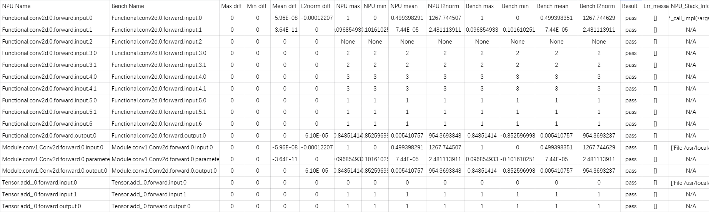
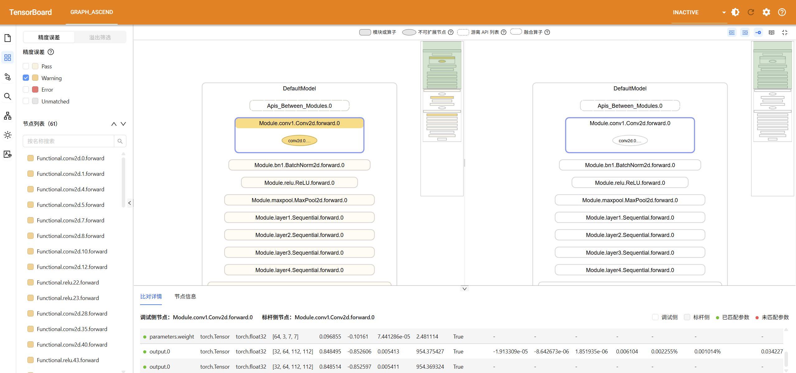

# hcuProbe PyTorch 场景快速入门

<br>

## 1. 概述

hcuProbe 是 AI 模型精度调试工具。本文以 ResNet-50 模型训练为例，演示 HCU/GPU 数据采集、精度比对及分级可视化构图比对的完整流程，帮助您掌握数值溢出、Loss 异常、模型不收敛等典型精度问题的排查方法与分析思路。

**体验地图（核心操作约需 10 分钟）**

| 步骤 | 环节 | 核心工具 | 操作耗时 | 原理学习 |
| :---: | :--- | :--- | :---: | :---: |
| 1 | 环境准备 | Docker 容器 | 5 min | 5 min |
| 2 | HCU 数据采集 | PrecisionDebugger | 1 min | 10 min |
| 3 | GPU 标杆采集 | PrecisionDebugger | 0.5 min | 5 min |
| 4 | 精度比对 | hcuProbe compare | 1 min | 10 min |
| 5 | 可视化构图比对 | graph_visualize / TensorBoard | 2 min | 10 min |

> 👉 本教程基于 PyTorch 框架。

## 2. 操作步骤

### 2.1 环境准备（必做）

🛑 **本节为强制前置步骤！跳过本节可能导致后续多项操作失败。**

本教程中 HCU 侧的操作仅支持在标准化 ROCm 容器环境中执行，不支持直接在裸机、虚拟机或其他非标准容器环境中执行。

#### 2.1.1 前置条件

开始前，请确认服务器满足以下要求：

| 项目 | 要求 | 验证方法 |
| --- | --- | --- |
| **硬件算力** | Linux 服务器配备至少 1 张 HCU 卡，驱动与固件已安装 | 执行 `hy-smi`，确认 HCU 卡状态正常 |
| **容器运行** | 已安装并运行 Docker（建议版本 ≥ 18.0） | 执行 `docker ps`，无报错即表示服务正常启动 |
| **网络通信** | 已安装 curl（任意版本） | 执行 `curl -V`，有版本信息输出即表示已安装 |

> 👉 确认前置条件满足后，若环境具备公网访问能力，本章 HCU 侧命令可全程直接 **Copy/Paste** 执行，无需手动输入或拼接，以避免因输入错误导致命令执行失败。

#### 2.1.2 宿主机：配置镜像环境变量

在宿主机执行以下命令：

```bash
export MY_STUDY_VAR_PYTORCH_IMAGE="harbor.sourcefind.cn:5443/dcu/admin/base/pytorch:2.9.0-ubuntu22.04-dtk26.04-py3.10"
```
> [!NOTE]说明
>
> 请手动配置WORKSPACE_HOME


#### 2.1.3 宿主机：拉取镜像

在宿主机执行：

```bash
docker pull ${MY_STUDY_VAR_PYTORCH_IMAGE}
```

#### 2.1.4 宿主机：启动容器

在宿主机执行以下命令，并根据终端提示确认容器创建信息：

```bash
docker run -it \
-v ${HOME}:${HOME} \
-v /public/home/:/public/home/:ro \
-v /opt/hyhal:/opt/hyhal:ro \
--shm-size=512G \
--privileged=true \
--device=/dev/kfd \
--device=/dev/dri \
--network host \
--group-add video \
-w ${HOME} \
--name hcuprobe_pytorch_quick_start \
harbor.sourcefind.cn:5443/dcu/admin/base/pytorch:2.9.0-ubuntu22.04-dtk26.04-py3.10 \
tail -f /dev/null
```

**预期结果**：终端显示类似以下的 root Shell 提示符，表示容器已成功启动并进入容器：

```text
[root@xxxxxx ~]#
```

#### 2.1.5 容器内：安装 hcuProbe

在容器内执行以下命令：

```bash
cd ~
git clone --branch 26.2.0-dev https://github.com/HYGON-AI/hcu_probe-das.git
cd hcu_probe-das
pip install .
```

#### 2.1.6 容器内：检查环境安装正确性

安装完成后执行环境检查命令：

```bash
python3 -c 'import torch; assert torch.cuda.is_available(), "HCU is unavailable"; import hcuprobe; print("PyTorch:", torch.__version__)' && hcuprobe --help >/dev/null && tensorboard --help >/dev/null && echo -e "\e[32m[PASS] HCU environment, hcuProbe and TensorBoard check passed.\e[0m"
```

若显示 `[PASS]`，表示 HCU 环境、Python 依赖、hcuProbe 和 TensorBoard 均已正常配置，可以继续进行下一步操作。

### 2.2 在 HCU 环境采集待调试数据

#### 2.2.1 准备采集配置

在容器内执行以下命令，将采集配置写入 `~/config.json`：

```bash
cat > ~/config.json << EOF
{
    "task": "statistics",
    "dump_path": "${HOME}/hcuprobe_dump_hcu",
    "rank": [],
    "step": [0, 1],
    "level": "mix",
    "async_dump": false,
    "statistics": {
        "scope": [],
        "list": [],
        "data_mode": ["all"],
        "summary_mode": "statistics"
    }
}
EOF
```

本配置采集第 0、1 两个训练迭代中 Module 和 API 层级的前向、反向输入输出统计量。采集结果可同时用于精度比对和分级可视化构图比对。由于 `task` 设置为 `statistics`，仅保存 Tensor 统计量，不保存完整的 Tensor 数据，可降低磁盘占用。

#### 2.2.2 准备模型训练代码

在容器内执行以下命令，将训练代码写入 `~/precision_sample.py`。脚本使用固定随机数据训练 ResNet-50 模型，并通过 `PrecisionDebugger` 采集精度数据。该模型包含卷积、归一化、激活、残差连接、池化和全连接等典型结构：

```python
cat > ~/precision_sample.py << 'EOF'
import os, argparse, torch, torch.nn as nn
from torch.utils.data import DataLoader
import torchvision.datasets as datasets, torchvision.models as models, torchvision.transforms as transforms
from hcuprobe.pytorch import PrecisionDebugger, seed_all

seed_all(seed=1234, mode=True)

parser = argparse.ArgumentParser()
parser.add_argument('--gpu', default=0, type=int)
args = parser.parse_args()

device = torch.device(f'cuda:{args.gpu}')
torch.cuda.set_device(args.gpu)
model = models.resnet50().to(device)
criterion = nn.CrossEntropyLoss().to(device)
optimizer = torch.optim.SGD(model.parameters(), lr=0.1, momentum=0.9, weight_decay=1e-4)
scheduler = torch.optim.lr_scheduler.StepLR(optimizer, step_size=30, gamma=0.1)
train_loader = DataLoader(datasets.FakeData(1281167, (3, 224, 224), 1000, transforms.ToTensor()), batch_size=32, shuffle=True, num_workers=4, pin_memory=True)
val_loader = DataLoader(datasets.FakeData(50000, (3, 224, 224), 1000, transforms.ToTensor()), batch_size=32, shuffle=False, num_workers=4, pin_memory=True)
debugger = PrecisionDebugger(config_path=os.path.expanduser("~/config.json"))

global_step = 0
total_epochs = 2
total_steps = total_epochs * len(train_loader)

for epoch in range(total_epochs):
    model.train()
    for i, (images, target) in enumerate(train_loader):
        debugger.start(model)
        images, target = images.to(device, non_blocking=True), target.to(device, non_blocking=True)
        loss = criterion(model(images), target)
        optimizer.zero_grad()
        loss.backward()
        optimizer.step()
        debugger.stop()

        if global_step % 10 == 0:
            print(f"Current Step: {global_step} (Progress: {global_step / total_steps:.2%})\tLoss: {loss.item():.4e}")

        debugger.step()
        global_step += 1

    model.eval()
    correct, total = 0, 0
    with torch.no_grad():
        for images, target in val_loader:
            images, target = images.to(device, non_blocking=True), target.to(device, non_blocking=True)
            correct += model(images).argmax(dim=1).eq(target).sum().item()
            total += target.size(0)
    print(f" * Finished Epoch Pool - Evaluation Acc@1: {100.0 * correct / total:.3f}%")
    scheduler.step()
EOF
```
#### 2.2.3 启动训练和采集

在容器内执行以下命令：

```bash
python3 ${HOME}/precision_sample.py --gpu 0
```

> 默认使用 0 号卡。若该卡不可用或需指定其他卡，请将 `--gpu 0` 中的数字替换为目标卡 ID。

当日志输出如下信息时，表明 step0/step1 精度数据采集已完成。此时后续训练迭代（step 2、3、4 等）仍会继续执行，可按 `Ctrl+C` 安全终止进程以节省时间，提前终止不会影响已采集的 step0/step1 数据完整性：

```text
2026-10-27 11:39:12 (342) [INFO] dump.json is at /root/hcuprobe_dump_hcu/step1.
2026-10-27 11:39:12 (342) [INFO] ****************************************************************************
2026-10-27 11:39:12 (342) [INFO] *                        hcuprobe ends successfully.                        *
2026-10-27 11:39:12 (342) [INFO] ****************************************************************************
```

> [!NOTE]说明
>
> **日志输出与手动终止原理**
> 脚本启动后即开始训练，由于 `config.json` 中配置 `"step": [0, 1]`，hcuprobe 仅在第 0、1 个训练迭代触发采集并输出相关日志；从第 2 个迭代起，hcuprobe 停止采集，终端仅输出训练脚本自身的日志（如 `Current Step: 10 (Progress: 0.01%)`）。此时 step0 与 step1 的精度数据已完整落盘，可安全终止训练进程。

#### 2.2.4 查看采集结果

运行以下命令，自动定位第 0 个训练迭代（`step0`）生成的 `dump.json` 并查看目录结构：

```bash
HCU_DUMP_JSON=$(find "${HOME}/hcuprobe_dump_hcu/step0" -type f -name dump.json | head -n 1)
echo "${HCU_DUMP_JSON}"
find "${HOME}/hcuprobe_dump_hcu" -maxdepth 3 -print
```

若成功输出 `dump.json` 路径，则表明数据采集正常。

单卡训练中，精度数据通常保存在 `proc{pid}` 目录；多卡训练则保存在 `rank{id}` 目录。常见结构如下：

```text
hcuprobe_dump_hcu
├── step0
│   └── proc{pid}
│       ├── construct.json
│       ├── dump.json
│       └── stack.json
└── step1
    └── proc{pid}
        ├── construct.json
        ├── dump.json
        └── stack.json
```

| 文件 | 说明 |
| :--- | :--- |
| `construct.json` | 记录 Module 层级关系信息 |
| `dump.json` | 包含 Module 和 API 在前向、反向过程中的输入输出统计量及溢出信息，是后续精度比对的核心输入 |
| `stack.json` | 记录 API 调用栈信息，用于从可疑 API 回溯至训练代码 |

### 2.3 在 GPU 环境采集标杆数据

本快速入门旨在体验 hcuprobe 核心功能，自行采集 GPU 数据对理解工具价值有限，建议直接使用预置示例数据：

```bash
cd ~
git clone --branch 26.2.0-dev https://github.com/HYGON-AI/hcu_probe-das.git
cp -rf ~/hcu_probe-das//examples/quick_start/gpu_dump ~/hcuprobe_dump_gpu
```

> [!NOTE]说明
>
> 预置 GPU 数据已覆盖典型精度问题特征，可将您的体验时间大幅缩短，聚焦于 msProbe 核心分析能力而非环境搭建。
> 如您想体验 GPU 采集数据过程，请参考 [第 4 章](#4-附录-a在-gpu-环境下训练模型并采集数据) 中的提示自主探索操作。

### 2.4 HCU 与 GPU 精度比对

#### 2.4.1 准备比对数据

在 HCU 容器内执行以下命令，重新定位双端数据路径：

```bash
HCU_DUMP_JSON=$(find "${HOME}/hcuprobe_dump_hcu/step0" -type f -name dump.json | head -n 1)
GPU_DUMP_JSON=$(find "${HOME}/hcuprobe_dump_gpu/step0" -type f -name dump.json | head -n 1)
echo "HCU: ${HCU_DUMP_JSON}"
echo "GPU: ${GPU_DUMP_JSON}"
```

确认两个变量均输出实际的 `dump.json` 路径后再继续执行比对。

#### 2.4.2 执行精度比对

在 HCU 容器内执行以下命令：

```bash
hcuprobe compare -tp "${HCU_DUMP_JSON}" -gp "${GPU_DUMP_JSON}" -o "${HOME}/accuracy_compare"
```

若输出如下信息，则表明比对成功：

```text
************************************************************************************
*                        hcuprobe compare ends successfully.                        *
************************************************************************************
```

#### 2.4.3 查看精度比对结果

执行以下命令查看生成的结果文件：

```bash
find "${HOME}/accuracy_compare" -maxdepth 1 -print
```

单卡场景会生成 `compare_result_{timestamp}.csv`（或 xlsx 格式），该文件列出参与比对的 API、数据类型、Tensor 形状、统计量误差、比对结论和错误信息等：


<div style="text-align: center;">
<strong>图 1</strong> 精度比对结果文件内容示例
</div>

查看结果时，建议按以下顺序分析：

1. **筛选异常**：根据 `Result` 列筛选未通过的 API；
2. **排查错误**：查看 `Err_Message`，判断是否存在 API 未匹配、数据类型或形状不一致等问题；
3. **比对统计**：针对已匹配但精度差异较大的 API，对比 Max、Min、Mean、L2 Norm 等统计量及相对误差；
4. **回溯代码**：结合 `HCU_Stack_Info` 或 HCU 侧 `stack.json`，定位可疑 API 对应的训练代码。

更多指标定义和结果解读方法，请参见《[精度比对结果分析](../user_guide/accuracy_compare/pytorch_accuracy_compare_instruct.md#精度比对结果分析)》。

### 2.5 分级可视化构图比对

分级可视化构图比对会还原两侧模型的 Module 和 API 层级结构，并将精度差异映射到图节点上，适合从整体模型结构逐层定位可疑节点。

#### 2.5.1 生成双图比对文件

在 HCU 容器内执行以下命令：

```bash
hcuprobe graph_visualize -tp "${HOME}/hcuprobe_dump_hcu" -gp "${HOME}/hcuprobe_dump_gpu" -o "${HOME}/graph_visualize_output"
```

执行完成后查看输出结果：

```bash
find "${HOME}/graph_visualize_output" -maxdepth 1 -print
```

输出目录中将生成如下文件：

```text
graph_visualize_output
└── compare_{timestamp}.vis.db
```

若提示模型结构为空，请确认 HCU 和 GPU 采集配置中的 `level` 均为 `mix` 或者均为 `L0`，并检查两侧 `construct.json` 文件内容是否为空。

#### 2.5.2 启动 TensorBoard

在 HCU 容器内执行以下命令：

```bash
tensorboard --logdir "${HOME}/graph_visualize_output" --bind_all
```

终端将输出类似如下访问地址（主机名和端口以实际日志为准）：

```text
TensorBoard 2.x.x at http://hostname:6006/ (Press CTRL+C to quit)
```

在浏览器中访问 `http://服务器IP:6006/`

#### 2.5.3 查看可视化比对结果

成功打开 TensorBoard 后，可看到如下双图比对结果：


<div style="text-align: center;">
<strong>图 2</strong> HCU 与 GPU 分级可视化构图比对
</div>

建议按以下顺序分析：

1. **确认数据**：在数据选择区确认所选 HCU 数据、GPU 数据、训练迭代（Step）及进程相互对应；
2. **逐级展开**：从模型顶层逐级展开 Module，优先关注颜色较深或标记为精度可疑的节点；
3. **搜索定位**：利用节点搜索功能，快速定位精度比对结果文件中发现的可疑 API；
4. **分析偏差**：选中节点后对比两侧统计量、精度指标及调用栈，判断首个显著偏差位置。

更多节点匹配、精度筛选、溢出检测和跨套件比对方法，请参见《[PyTorch 场景分级可视化构图比对](../user_guide/accuracy_compare/pytorch_visualization_instruct.md)》。

### 2.6 后续进阶路径

恭喜您完成 hcuprobe 快速入门体验，您已掌握 hcuprobe 的基础使用方法。如需深入了解其功能用法，请参考：

- 《[训练前配置检查](../user_guide/config_check_instruct.md)》
- 《[训练状态监测](../user_guide/monitor_instruct.md)》
- 《[PyTorch 场景数据采集](../user_guide/dump/pytorch_data_dump_instruct.md)》
- 《[PyTorch 场景精度比对](../user_guide/accuracy_compare/pytorch_accuracy_compare_instruct.md)》
- 《[PyTorch 场景分级可视化构图比对](../user_guide/accuracy_compare/pytorch_visualization_instruct.md)》

## 4. 附录 A：在 GPU 环境下训练模型并采集数据

若需自行采集，请确保 GPU 环境已安装与 HCU 环境版本一致的 PyTorch，并安装 hcuProbe：

```bash
git clone --branch 26.2.0-dev https://github.com/HYGON-AI/hcu_probe-das.git
cd hcu_probe-das
pip install .
```

在 GPU 环境执行以下命令创建采集配置：

```bash
cat > ~/config.json << EOF
{
    "task": "statistics",
    "dump_path": "${HOME}/msprobe_dump_gpu",
    "rank": [],
    "step": [0, 1],
    "level": "mix",
    "async_dump": false,
    "statistics": {
        "scope": [],
        "list": [],
        "data_mode": ["all"],
        "summary_mode": "statistics"
    }
}
EOF
```

参照 [第 2.2.2 节](#222-准备模型训练代码) 将训练代码写入 `~/precision_sample.py`，随后启动训练与数据采集：

```bash
python3 ${HOME}/precision_sample.py --gpu 0
```

采集完成后，执行以下命令打包数据，以便传输至 HCU 容器：

```bash
tar -czvf ${HOME}/msprobe_dump_gpu.tar.gz ${HOME}/msprobe_dump_gpu
```
